# Kiến trúc dự án

> Tài liệu này là bản đồ kiến trúc để người mới lần theo luồng dữ liệu và biết nên tìm ở đâu khi sửa lỗi hoặc thêm tính năng. Nội dung mô tả source hiện tại; phần chưa tích hợp được ghi rõ, không xem thiết kế dự kiến là chức năng đã chạy.

## 1. Mục tiêu và ranh giới hệ thống

Dự án hướng tới phân loại tắc sống, tắc chín và tắc hư bằng Raspberry Pi 5 và STM32F103C8T6:

- **Raspberry Pi:** nhận hình ảnh, chạy YOLO và quyết định loại quả.
- **UART qua USB-UART CP2102:** chuyển byte giữa Pi và STM32. Hai đầu cần cùng cấu hình; firmware hiện đặt USART1 ở 115200 baud, 8N1.
- **STM32:** nhận lệnh, lập lịch bằng deadline, điều khiển hai servo MG90S và motor JGB37 qua BTS7960. Cảm biến E3F-DS30C4 dự kiến bổ sung sau; hiện chưa tham gia quyết định gạt.
- **Thống kê/dashboard:** dự kiến SQLite và giao diện sản lượng theo ngày; hiện chưa triển khai `store.py` hoặc web server trong package vận hành.

Hướng thiết kế là xử lý theo sự kiện, hạn chế polling. Pi chờ frame camera và sender chờ Condition; STM32 dùng ngắt UART, timer deadline và WFI khi không còn việc. `app.py` và `main.c` điều phối, các mô-đun xử lý trách nhiệm riêng.

## 2. Bố cục thư mục

- `RaspberryPi/ModelTest/`: công cụ thử Roboflow cũ, chạy riêng; không phải pipeline vận hành.
- `RaspberryPi/DataCollector/`: thu thập ảnh và kiểm tra chất lượng dữ liệu; không phải luồng điều khiển băng tải.
- `RaspberryPi/conveyor/`: package vận hành Pi, có camera, detector, tracker, crossing, sender và CLI PING/START/RUN.
- `RaspberryPi/tests/`: kiểm thử cấu hình, UART, detector, camera và tích hợp app bằng phần cứng giả.
- `RaspberryPi/models/`: chứa trọng số `best.pt` cục bộ, ngoài Git.
- `RaspberryPi/runtime/`: kết quả chạy sinh ra, ngoài Git. `conveyor/config.toml` là cấu hình cá nhân, cũng ngoài Git; mẫu dùng chung ở `config.example.toml`.
- `STM32Firmware/Core/Inc`, `STM32Firmware/Core/Src`: header và mã ứng dụng STM32.
- `STM32Firmware/Drivers/`: HAL/CMSIS của ST.
- `STM32Firmware/STM32Firmware.ioc`: cấu hình CubeMX của vi điều khiển và ngoại vi.
- `STM32Firmware/cmake/`, `CMakeLists.txt`, `CMakePresets.json`: cấu hình biên dịch.

### 2.1 Luồng vận hành tổng thể

```mermaid
flowchart LR
    Camera[Picamera2] --> Detector[YOLO CPU]
    Detector --> Tracker[Tracker: ID qua các frame]
    Tracker --> Crossing[Crossing: tâm quả vượt vạch]
    Crossing --> Queue[Hàng đợi gửi có giới hạn]
    Queue --> Sender[Một luồng Sender]
    Sender --> Protocol[UartProtocol: frame và retry]
    Protocol --> UART[CP2102 / USART1]
    UART --> Parser[STM32 uart_protocol]
    Parser --> App[main.c: callback]
    App --> Products[ProductQueue: deadline]
    Products --> Timer[TIM4: deadline sớm nhất]
    Timer --> Servo[Servo FSM / TIM2]
    App --> State[System FSM]
    State --> Motor[BTS7960 / TIM3]
```



Response quay về cùng liên kết UART. Pi chỉ biết lệnh đã được STM32 chấp nhận qua ACK; chưa có phản hồi xác nhận quả thực sự vào đúng hộp.

### 2.2 Trách nhiệm các mô-đun Pi

| File trong `RaspberryPi/conveyor/` | Trách nhiệm/API chính |
|---|---|
| `__main__.py`, `app.py` | Điểm chạy `python -m conveyor`; đọc CLI/cấu hình, nối thành phần, quản lý khởi động và đóng tài nguyên. |
| `config.py` | `load_config()` đọc TOML, kiểm tra serial/camera/detector, đổi đường dẫn model tương đối thành tuyệt đối theo thư mục TOML. Chưa kiểm tra file trọng số tồn tại. |
| `events.py` | Các dataclass bất biến `Detection`, `TrackedDetection`, `CrossingEvent`. |
| `vision/camera.py` | `Camera.start()/read()/close()` quản lý Picamera2; trả `(frame BGR, timestamp cảm biến tính bằng giây)`. |
| `vision/detector.py` | `Detector` tải `.pt` một lần; `predict()` chạy CPU, trả box trên ảnh gốc, tên lớp và confidence. |
| `vision/tracker.py` | `Tracker.update()` ghép tâm box gần nhất một-một; cấp ID tăng dần cho detection chưa ghép được. |
| `vision/crossing.py` | `CrossingDetector.update()` phát tối đa một sự kiện/ID khi tâm vượt vạch đúng chiều. |
| `communication/sender.py` | `Sender.start()/submit()/stop()` quản lý hàng đợi và một worker, gọi callback kết quả UART. |
| `vision/annotate_images.py` | Công cụ thử model trên thư mục ảnh, xuất ảnh có box và báo cáo; không điều khiển băng tải. |

Camera được cấu hình RGB888, tương ứng mảng BGR; `read()` sao chép ảnh trước khi release request. Timestamp lấy từ `SensorTimestamp` của cùng request, đổi nanosecond sang giây. Đây là đồng hồ tăng đơn điệu từ lúc khởi động, không phải ngày giờ thực. Cấu hình tay hiện đặt trong `camera.py`: `AfMode=0`, `LensPosition=10.0`, `AeEnable=False`, `ExposureTime=2000 µs`, `AnalogueGain=2.0`; width/height/fps lấy từ TOML.

Detector yêu cầu file `.pt` tồn tại, task `detect` và đúng ba nhãn `green/riped/damaged`; lấy ánh xạ class ID từ metadata, không giả định thứ tự lớp. Lỗi tải trọng số được báo thay vì chọn model thay thế. PING/START riêng không import hoặc tải thư viện vision.

Tracker không dùng nhãn để ghép, nên đổi nhãn vẫn giữ ID. Mặc định thử: `max_distance_px=80.0`, `max_age_seconds=0.5`; cấu hình bảng `[tracker]` có thể ghi đè. ID hết hạn không được tái sử dụng trong cùng instance. Quả sát nhau, che khuất hoặc inference chậm có thể gây đổi ID; thuật toán tham lam không bảo đảm ghép tối ưu toàn cục.

Crossing dùng tọa độ chuẩn hóa theo ảnh camera gốc, không theo `imgsz` của model. Với quả đi từ dưới lên, dùng cấu hình sau (file mẫu dùng chung vẫn minh họa trục x):

```toml
[crossing]
axis = "y"
position = 0.5
direction = "decreasing"
```

Ảnh cao 640 pixel thì vạch ở y=320. Quả phải được quan sát trước vạch; xuất hiện lần đầu phía sau vạch chưa được tính. Sự kiện lưu nhãn/confidence của frame xác nhận vượt vạch. Trạng thái chống phát lại được giữ đến hết lần chạy, bộ nhớ tăng theo số ID; không chống trùng được nếu tracker cấp nhầm ID mới cho cùng quả.

Sender ánh xạ `green → UNRIPE`, `riped → RIPE`, `damaged → SPOILED`. `queue_capacity=16` chỉ tính phần đang chờ, ngoài một giao dịch đang gửi. Worker ngủ bằng Condition khi rỗng, chỉ gọi `exchange()` một lần cho mỗi sự kiện; retry thuộc protocol. Callback `on_result(event, response, error)` chạy trong worker, hiện in kết quả ra terminal. Queue đầy, FULL/NOT_READY hết lượt thử, lỗi giao dịch hoặc callback làm sender chặn nhận mới; các sự kiện chưa gửi được giữ trong `pending_events`.

### 2.3 Khởi động, chạy và dừng Pi

Từ thư mục `RaspberryPi`, với venv có Picamera2 và các dependency vision:

```sh
.venv/bin/python -m conveyor --run --config conveyor/config.toml
```

`--ping`, `--start`, `--run` loại trừ nhau. `--run` thực hiện:

1. Đọc cấu hình, khởi tạo crossing/tracker và tải detector.
2. Mở UART, gửi PING và yêu cầu PONG.
3. Khởi tạo sender, mở camera và warmup model trên frame thật; kết quả warmup không gửi UART.
4. Gửi START, yêu cầu ACK, rồi khởi chạy worker gửi.
5. Chờ frame → predict → tracker → crossing → submit; in số track, thời gian inference, CROSS và ACK/lỗi.

Camera và inference chạy độc lập với người xem web. Ctrl+C trả exit code 130; lỗi pipeline trả 1. Khi thoát, app chờ giao dịch đang thực hiện, in các sự kiện NOT SENT, đóng camera rồi đóng UART. Lỗi sender được kiểm tra giữa các bước xử lý frame; chưa có cơ chế ngắt capture/inference đang chạy ngay lập tức.

**Dừng chương trình Pi không tự dừng motor STM32.** Giao thức chưa có STOP hoặc heartbeat; dùng debugger `servo_test_command=3`. Sau giao dịch không rõ kết quả, không tạo protocol mới để gửi bù; phải dừng và khôi phục hệ thống/phiên UART có kiểm soát.

## 3. UART

### 3.1 Định nghĩa giao thức

UART dùng 115200 baud, 8 data bit, không parity, 1 stop bit (8N1). Mỗi frame dài 4 byte; các byte truyền theo thứ tự từ trái sang phải.

```text
Pi → STM32: [SOF_REQ, SEQ, CMD, CRC8]
STM32 → Pi: [SOF_RESP, SEQ, STATUS, CRC8]
```

| Trường | Giá trị và ý nghĩa |
|---|---|
| `SOF_REQ` | `0xA5`, byte bắt đầu request từ Pi. |
| `SOF_RESP` | `0x5A`, byte bắt đầu response từ STM32. |
| `SEQ` | Số thứ tự 8 bit, từ `0x00` đến `0xFF`; tăng modulo 256 sau ACK/PONG. Khi gửi lại cùng giao dịch, giữ nguyên SEQ và CMD. |
| `CMD` | `0x01` PING; `0x02` UNRIPE; `0x03` RIPE; `0x04` SPOILED; `0x05` START. |
| `STATUS` | `0x00` PONG; `0x01` ACK; `0x02` FULL; `0x03` NOT_READY; `0x04` BAD_CMD. |
| `CRC8` | CRC-8/ATM tính trên ba byte đầu của frame tương ứng: SOF, SEQ và CMD hoặc STATUS. |

CRC-8/ATM dùng `width=8`, `poly=0x07`, `init=0x00`, `RefIn=false`, `RefOut=false`, `XorOut=0x00`. Hai đầu phải tính CRC trên cùng ba byte theo cùng thứ tự.

| STATUS | Ý nghĩa |
|---|---|
| `PONG` (`0x00`) | Response cho `PING`, xác nhận thiết bị đang phản hồi. |
| `ACK` (`0x01`) | STM32 đã nhận frame hợp lệ và chấp nhận lệnh để xử lý; không xác nhận servo đã gạt thành công. |
| `FULL` (`0x02`) | Lệnh hợp lệ nhưng chưa được chấp nhận vì hàng đợi đầy. Có thể thử lại cùng SEQ/CMD. |
| `NOT_READY` (`0x03`) | Lệnh hợp lệ nhưng chưa được chấp nhận vì STM32 chưa sẵn sàng. Có thể thử lại cùng SEQ/CMD theo chính sách tầng gọi. |
| `BAD_CMD` (`0x04`) | CMD không được hỗ trợ; đây là lỗi cấu hình/lập trình, không nên retry vô hạn. |

Pi duy trì tối đa một giao dịch đang chờ phản hồi. Retry do timeout dùng lại đúng frame/SEQ; STM32 cần ghi nhớ SEQ và CMD gần nhất đã chấp nhận để trả lại ACK khi gặp bản gửi trùng mà không đưa lệnh vào FSM lần thứ hai. FULL/NOT_READY không được ghi nhận là lệnh đã chấp nhận. CRC sai hoặc frame không hoàn chỉnh không được xử lý như lệnh hợp lệ.

### 3.2 UART phía STM32

File triển khai: `STM32Firmware/Core/Src/uart_link.c`; khai báo API: `STM32Firmware/Core/Inc/uart_link.h`. Mô-đun thực hiện truyền/nhận byte bằng ngắt và cung cấp buffer cho tầng ứng dụng. Nó chưa phân tích frame giao thức.

#### 3.2.1 `uart_link.c/.h`

**Biến và buffer trong `uart_link.c`**

- `UART_LINK_BUFFER_SIZE`: kích thước mỗi buffer vòng TX/RX, hiện là 64 byte.
- `link_uart`: con trỏ tới `UART_HandleTypeDef` được truyền vào `UartLink_Init()`.
- `rx_byte`: vùng HAL ghi byte nhận được trong lần nhận ngắt hiện tại.
- `rx_buffer[64]`: buffer vòng RX. `rx_head` là vị trí ghi tiếp; `rx_tail` là vị trí đọc tiếp. Một ô được chừa để phân biệt đầy/rỗng, nên chứa tối đa 63 byte.
- `rx_overflow`: cờ báo RX đầy và byte mới nhận đã bị bỏ.
- `rx_recovery_needed`: cờ yêu cầu khởi động lại nhận sau lỗi UART.
- `tx_buffer[64]`: buffer vòng TX. `tx_head` là byte truyền tiếp; `tx_tail` là vị trí ghi tiếp; `tx_count` là số byte đang chờ gửi. TX có thể chứa đủ 64 byte.
- `tx_active`: cho biết HAL đang truyền một byte.
- `tx_recovery_needed`: cờ yêu cầu thử khởi động lại truyền sau lỗi.
- Các biến trạng thái dùng chung giữa callback ngắt và ứng dụng được khai báo `volatile`. Các thao tác buffer trong ứng dụng khóa ngắt và khôi phục trạng thái ngắt trước đó.

**Hàm công khai trong `uart_link.h`:**

- `UartLink_Init(UART_HandleTypeDef *huart)`: trả `HAL_ERROR` nếu handle NULL; nếu hợp lệ thì lưu UART, đặt lại các chỉ số buffer/cờ và bắt đầu nhận một byte bằng `HAL_UART_Receive_IT()`. Trả trạng thái HAL của thao tác nhận.
- `UartLink_Send(const uint8_t *data, uint16_t length)`: kiểm tra UART, con trỏ và độ dài; chép toàn bộ dữ liệu vào TX buffer nếu còn chỗ. Trả `HAL_ERROR` khi tham số không hợp lệ, `HAL_BUSY` khi buffer không đủ chỗ, hoặc `HAL_OK` khi dữ liệu đã được xếp hàng. Nếu chưa có truyền đang chạy, hàm bắt đầu truyền byte đầu tiên. `HAL_OK` không xác nhận byte đã được Pi nhận.
- `UartLink_Read(uint8_t *data, uint16_t max_length)`: chép ngay tối đa `max_length` byte đang có trong RX buffer vào `data`, rồi trả số byte đã lấy. Hàm không chờ đủ dữ liệu và không ghép frame. Con trỏ NULL hoặc độ dài 0 trả về 0.
- `UartLink_RxOverflowed(void)`: trả cờ RX overflow hiện tại rồi xóa cờ để lần gọi sau chỉ báo overflow mới.
- `UartLink_Service(void)`: thử đăng ký lại nhận nếu `rx_recovery_needed` được đặt; thử khởi động lại truyền nếu `tx_recovery_needed` được đặt và còn byte trong TX buffer. Trả trạng thái HAL của thao tác phục hồi; trả `HAL_ERROR` nếu UART chưa khởi tạo.

**Callback và hoạt động truyền nhận:**

- `HAL_UART_RxCpltCallback(huart)`: bỏ qua UART không thuộc `link_uart`. Với UART này, nếu không có lỗi thì chép `rx_byte` vào RX buffer; nếu buffer đầy thì bật `rx_overflow` và bỏ byte mới. Sau đó đăng ký nhận byte kế tiếp. Nếu đăng ký nhận thất bại, hủy nhận và đặt `rx_recovery_needed`.
- `HAL_UART_ErrorCallback(huart)`: với UART của mô-đun, hủy nhận hiện tại và đặt `rx_recovery_needed` để `UartLink_Service()` phục hồi.
- `HAL_UART_TxCpltCallback(huart)`: sau khi một byte truyền xong, tăng `tx_head`, giảm `tx_count`; nếu còn byte thì khởi động byte kế tiếp, nếu hết thì xóa `tx_active`.
- `UartLink_StartTransmit()` (hàm nội bộ): gọi `HAL_UART_Transmit_IT()` để truyền một byte tại `tx_buffer[tx_head]`. Nếu HAL không nhận yêu cầu truyền, xóa `tx_active` và đặt `tx_recovery_needed`.
- `USART1_IRQHandler()` trong `stm32f1xx_it.c` chuyển ngắt USART1 cho HAL; HAL xử lý ngắt và gọi callback phù hợp.

Luồng nhận: HAL nhận một byte vào `rx_byte` → callback chép byte vào `rx_buffer` → ứng dụng gọi `UartLink_Read()` để lấy byte. Luồng gửi: ứng dụng gọi `UartLink_Send()` → dữ liệu được xếp vào `tx_buffer` → HAL truyền từng byte bằng ngắt và callback lần lượt khởi động byte kế tiếp.

#### 3.2.2 `uart_protocol.c/.h`

`STM32Firmware/Core/Src/uart_protocol.c` ghép request từ byte stream, kiểm tra frame và tạo response. `STM32Firmware/Core/Inc/uart_protocol.h` định nghĩa mã lệnh, mã trạng thái, callback cho tầng ứng dụng và API xử lý. Module dùng `UartLink_Read()`/`UartLink_Send()`; không tự quyết định trạng thái FSM.

**Hằng số, kiểu dữ liệu và trạng thái:**

- `UART_PROTOCOL_REQUEST_SOF`: byte bắt đầu request Pi → STM32, `0xA5`.
- `UART_PROTOCOL_RESPONSE_SOF`: byte bắt đầu response STM32 → Pi, `0x5A`.
- `UART_PROTOCOL_FRAME_SIZE`: độ dài frame, 4 byte.
- `UART_PROTOCOL_CRC_POLYNOMIAL`: polynomial CRC-8/ATM, `0x07`.
- `UART_PROTOCOL_READ_CHUNK_SIZE`: số byte tối đa mỗi lần lấy từ RX buffer, 16.
- `UartProtocol_Command_t`: `PING=0x01`, `UNRIPE=0x02`, `RIPE=0x03`, `SPOILED=0x04`, `START=0x05`.
- `UartProtocol_Status_t`: `PONG=0x00`, `ACK=0x01`, `FULL=0x02`, `NOT_READY=0x03`, `BAD_CMD=0x04`, đồng nhất với bảng ở mục 3.1.
- `request_frame[4]`: các byte request đang được ghép; `request_length` là số byte hiện có.
- `command_handler`: callback do ứng dụng đăng ký để quyết định lệnh phân loại mới được chấp nhận hay trả `FULL`/`NOT_READY`.
- `has_last_accepted`, `last_accepted_sequence`, `last_accepted_command`: ghi nhớ request phân loại gần nhất đã được callback xác nhận `ACK`, dùng để xử lý retry trùng.

**Hàm và cách xử lý:**

- `UartProtocol_Init(command_handler)`: lưu callback, xóa frame đang ghép và xóa trạng thái SEQ/CMD đã chấp nhận. Gọi lại hàm này sẽ khởi tạo lại trạng thái chống trùng.
- `UartProtocol_Process()`: gọi `UartLink_Service()`, kiểm tra cờ RX overflow (nếu overflow thì bỏ frame dở), lấy các byte đang có bằng `UartLink_Read()` theo từng nhóm tối đa 16 byte rồi chuyển từng byte cho parser. Trả lỗi HAL khi service hoặc gửi response thất bại; ứng dụng nên gọi hàm này từ vòng điều phối chính.
- `UartProtocol_Crc8(data, length)` (nội bộ): tính CRC-8/ATM với init `0x00`, poly `0x07`, không reflect, xorout `0x00`.
- `UartProtocol_ConsumeByte(byte)` (nội bộ): bỏ byte cho đến `0xA5`, ghép đủ 4 byte rồi chuyển frame đi xử lý. Nếu CRC sai, bỏ frame và tìm lại `0xA5` trong các byte đã thu để đồng bộ lại.
- `UartProtocol_HandleFrame(frame)` (nội bộ): kiểm tra CRC; CRC sai thì im lặng bỏ frame. CMD ngoài danh sách trả `BAD_CMD`. `PING` trả `PONG`. Với lệnh phân loại, nếu SEQ/CMD trùng request đã ACK gần nhất thì trả ACK lần nữa mà không gọi callback. Cùng SEQ nhưng CMD khác trả `BAD_CMD`. Lệnh mới được chuyển cho `command_handler`; chỉ kết quả `ACK`, `FULL`, `NOT_READY` được chấp nhận làm kết quả callback, các giá trị khác được đổi thành `BAD_CMD`. Chỉ khi callback trả `ACK` mới lưu SEQ/CMD chống trùng; FULL/NOT_READY không được lưu để retry có thể được đánh giá lại.
- `UartProtocol_SendResponse(sequence, status)` (nội bộ): đóng gói `[0x5A, SEQ, STATUS, CRC8]` và gửi qua `UartLink_Send()`.

Trạng thái SEQ được ghi nhận trước khi gửi ACK. Vì vậy, nếu ACK không xếp được vào TX buffer hoặc bị mất trên đường truyền, request retry cùng SEQ/CMD được nhận diện là bản gửi lại và chỉ phát lại ACK, không gọi `command_handler` lần thứ hai. Parser chỉ lưu request đã ACK gần nhất; giao thức Pi dùng stop-and-wait nên chỉ có một giao dịch đang chờ.

### 3.3 UART phía Pi

#### 3.3.1 `RaspberryPi/conveyor/communication/serial_link.py`

`UartLink` cung cấp byte I/O bằng thư viện `pyserial`; không tạo hoặc phân tích frame.

**Thuộc tính của `UartLink`:**

- `port`: tên cổng serial, ví dụ cổng CP2102.
- `baudrate`: tốc độ truyền, mặc định `115200`.
- `read_timeout`: thời gian chờ tối đa cho một lần đọc, mặc định `0.1` giây.
- `write_timeout`: thời gian chờ tối đa cho một lần ghi, mặc định `1.0` giây.
- `_serial`: đối tượng serial nội bộ; là `None` khi cổng chưa mở.
- `is_open`: property trả về cổng đã được mở và còn hoạt động hay chưa.

**Hàm của `UartLink`:**

- `__init__(port, baudrate, read_timeout, write_timeout)`: lưu cấu hình cổng và khởi tạo `_serial` là `None`.
- `open()`: nếu cổng chưa mở, tạo `serial.Serial` với 8 data bit, parity none, 1 stop bit và các timeout đã cấu hình. Nếu cổng đang mở thì không làm gì.
- `close()`: đóng cổng nếu đã có đối tượng serial, sau đó đặt `_serial` về `None`.
- `send(data)`: báo `PortNotOpenError` nếu cổng chưa mở; đổi dữ liệu thành `bytes`; dữ liệu rỗng trả 0; nếu có dữ liệu thì gọi `write()`, `flush()` và trả số byte được ghi.
- `receive(max_length=1, timeout=None)`: báo `PortNotOpenError` nếu cổng chưa mở; báo `ValueError` nếu `max_length <= 0` hoặc timeout âm; nếu hợp lệ thì đọc tối đa số byte yêu cầu. Khi truyền `timeout`, hàm tạm đặt read timeout của serial theo giá trị đó rồi khôi phục timeout cấu hình ban đầu; timeout bằng 0 trả ngay `b""`. Hết timeout chỉ kết thúc lần đọc, không đóng kết nối serial.
- `__enter__()` / `__exit__(...)`: cho phép dùng context manager `with`; khi vào thì mở cổng, khi thoát thì đóng cổng.

#### 3.3.2 `RaspberryPi/conveyor/communication/protocol.py`

File này xây dựng frame và quản lý giao dịch trên `UartLink`. Nó chưa quyết định loại quả cần phân loại hoặc điều khiển FSM.

**Hằng số và kiểu dữ liệu:**

- `SOF_REQUEST = 0xA5`, `SOF_RESPONSE = 0x5A`: byte bắt đầu frame theo từng chiều.
- `FRAME_SIZE = 4`: số byte trong mỗi frame.
- `CRC_POLYNOMIAL = 0x07`: polynomial dùng cho CRC-8/ATM.
- `Command`: `PING=0x01`, `UNRIPE=0x02`, `RIPE=0x03`, `SPOILED=0x04`, `START=0x05`.
- `Status`: `PONG=0x00`, `ACK=0x01`, `FULL=0x02`, `NOT_READY=0x03`, `BAD_CMD=0x04`.
- `Response(sequence, status)`: đối tượng bất biến chứa SEQ và STATUS đã giải mã.
- `ProtocolError`: lớp lỗi cơ sở. `TransportError` báo lỗi đọc/ghi serial; `TransactionTimeout` báo không có response hợp lệ sau các lần gửi; `UncertainTransaction` báo giao dịch trước chưa rõ kết quả và chặn gửi lệnh mới.

**Hàm tạo và kiểm tra frame:**

- `crc8_atm(data)`: bắt đầu CRC bằng `0x00`, XOR từng byte vào CRC rồi xử lý 8 bit theo polynomial `0x07`; trả một byte CRC.
- `build_request(sequence, command)`: kiểm tra SEQ thuộc `0..255`, chuyển CMD thành `Command`, tạo `[SOF_REQUEST, SEQ, CMD]` và nối CRC tính trên ba byte đó. Trả frame 4 byte; không gửi dữ liệu.
- `decode_response(frame)`: đổi dữ liệu đầu vào thành `bytes`; kiểm tra độ dài 4 byte, `SOF_RESPONSE`, CRC và STATUS hợp lệ. Trả `Response` nếu hợp lệ, nếu không trả `None`.

**Cấu hình và trạng thái của `UartProtocol`:**

- `uart`: đối tượng transport có các hàm `send()` và `receive()`.
- `sequence`: SEQ hiện tại; mặc định ban đầu là `0`, tăng modulo 256 sau response `ACK` hoặc `PONG` hợp lệ với CMD đang chờ.
- `transaction_timeout`: thời gian chờ response hợp lệ sau mỗi lần gửi, mặc định `0.1` giây.
- `frame_timeout`: thời gian tối đa để nhận đủ một frame kể từ byte SOF, mặc định `0.02` giây. Hết hạn thì bỏ frame dở và tiếp tục tìm frame mới đến hết deadline giao dịch.
- `max_attempts`: tổng số lần gửi tối đa cho một giao dịch, tính cả lần đầu; mặc định `3`.
- `retry_delay`: thời gian nghỉ giữa các lần gửi lại sau timeout, mặc định `0.02` giây.
- `temporary_status_delay`: thời gian nghỉ trước khi thử lại sau `FULL` hoặc `NOT_READY`, mặc định `0.1` giây.
- `_uncertain_command`: CMD của giao dịch có kết quả chưa rõ; khi khác `None`, `_exchange()` từ chối lệnh mới.
- `_transaction_lock`: khóa không chờ để chỉ cho phép một `exchange()` hoạt động tại một thời điểm.

**Hàm giao dịch:**

- `__init__(...)`: kiểm tra SEQ khởi đầu, timeout giao dịch, timeout frame và số lần thử; lưu UART cùng cấu hình, khởi tạo trạng thái chưa rõ và khóa giao dịch.
- `exchange(command)`: chiếm `_transaction_lock`; nếu giao dịch khác đang chạy thì ném `ProtocolError`. Gọi `_exchange()` và luôn nhả khóa khi kết thúc.
- `_exchange(command)`: chuyển CMD thành `Command`; từ chối nếu `_uncertain_command` đã được đặt; tạo frame theo SEQ hiện tại. Gửi cùng frame tối đa `max_attempts` lần. Nếu ghi lỗi hoặc ghi thiếu byte thì đặt `_uncertain_command` và ném `TransportError`. Sau mỗi lần gửi, đợi `_read_response()` đến deadline. Nếu hết hạn thì nghỉ `retry_delay` rồi retry cùng SEQ/CMD; hết lượt thì đặt `_uncertain_command` và ném `TransactionTimeout`. `ACK` hoặc `PONG` hợp lệ làm tăng SEQ và trả response; `BAD_CMD` trả response ngay; `FULL`/`NOT_READY` chờ `temporary_status_delay` rồi thử lại nếu còn lượt, cuối cùng trả response cuối.
- `_read_response(deadline, command)`: đọc từng byte qua `uart.receive(1, timeout=...)`, bỏ dữ liệu trước `SOF_RESPONSE`, gom ứng viên đủ 4 byte, giải mã bằng `decode_response()` và chỉ trả response có SEQ bằng SEQ đang chờ cùng STATUS phù hợp với CMD (`PING` nhận `PONG` hoặc `BAD_CMD`; lệnh phân loại không nhận `PONG`). Mỗi lần đọc bị giới hạn bởi giá trị nhỏ nhất giữa read timeout cấu hình, thời gian còn lại của giao dịch và thời gian còn lại của frame. Frame dở quá `frame_timeout` bị bỏ; ứng viên không hợp lệ, sai SEQ hoặc sai cặp CMD/STATUS bị trượt từng byte để tìm frame tiếp theo. Trả `None` khi hết deadline.

### 3.4 Hạn chế và phần chưa triển khai

- `main.c` đã gọi `UartLink_Init()`, `UartProtocol_Init(App_HandleProductCommand)` và xử lý `UartProtocol_Process()` trong vòng chính. Callback nhận sản phẩm chỉ khi RUNNING và ACK sau khi thêm được vào ProductQueue.
- START được callback xử lý trước điều kiện RUNNING: READY → RUNNING và bật motor LPWM ở duty 30%; đã RUNNING thì ACK, INIT/STOPPED/FAULT thì NOT_READY. START không xóa lỗi hoặc hàng đợi. Retry bản đã ACK được parser trả ACK mà không gọi lại callback.
- STM32 parser hiện chưa có timeout ghép frame theo thời gian. Frame dở được giữ cho đến khi đủ byte, RX overflow hoặc khởi tạo lại parser.
- Phía Pi đã nối inference với UART qua sender. Một protocol được dùng cho PING, START rồi độc quyền bởi worker gửi; không gửi PING song song khi pipeline đang chạy.
- Giới hạn timeout của serial ngăn một lần `read()` chờ lâu hơn thời gian còn lại được yêu cầu, nhưng Python/Linux không phải hệ thống thời gian thực; scheduling của hệ điều hành có thể làm hàm trả về trễ nhẹ so với deadline.
- Khi hết retry do timeout hoặc gặp lỗi transport, `exchange()` dừng và ném `TransactionTimeout` hoặc `TransportError` lên tầng gọi. Giao dịch mới bị chặn bởi `_uncertain_command` và sẽ ném `UncertainTransaction`; ứng dụng nhận lỗi và dừng luồng gửi trên đối tượng protocol hiện tại.
- Cơ chế chống trùng chỉ lưu SEQ/CMD gần nhất đã ACK trong RAM. Nếu STM32 reset, trạng thái này mất; giao thức chưa có boot/session ID để xác định reset và khôi phục giao dịch đang chờ.
- `UartProtocol_Process()` đã đọc `UartLink_RxOverflowed()` để bỏ frame dở. RX buffer 64 byte có sức chứa thực tế 63 byte; khi đầy, byte nhận mới bị bỏ.
- Các timeout và retry của Pi đang là cấu hình khởi đầu trong source; cần hiệu chỉnh khi đo trên phần cứng. Chưa xác nhận hoạt động hai chiều của giao thức trên hệ thống thực.

## 4. Điều phối và phần cứng STM32

### 4.1 Servo

`servo.h/.c` cung cấp `Set_Servo_Angle()` đổi góc sang compare PWM. TIM2 dùng CH1/CH2, bộ đếm 1 MHz và chu kỳ 20 ms. `servo_fsm.h/.c` có một instance cho mỗi servo; nhận sự kiện Start/Stop/Timeout, trả `ServoFsmOutput` để `main.c` áp góc ngay.

Chu trình: UNINITIALIZED → IDLE → DEFLECTING → HOLDING → RETURNING → IDLE. Cấu hình hiện tại cho cả hai servo: góc nghỉ 0°, góc gạt 45°, gạt 200 ms, giữ 2000 ms, hồi 200 ms. Đây là thời gian ước tính, không có xác nhận cơ khí. Servo 1 gạt quả sống; servo 2 gạt quả hư; quả chín đi thẳng.

`cycle_completed` tăng bộ đếm hoàn tất chu trình trong debugger, không đồng nghĩa xác nhận quả vào hộp. Nếu sản phẩm đến hạn mà servo chưa sẵn sàng, app dừng motor, chuyển FAULT, dừng cả hai FSM servo và giữ bản ghi sản phẩm lỗi thay vì gạt trễ.

### 4.2 Motor

`motor.h/.c` điều khiển BTS7960: RPWM = TIM3 CH3, LPWM = TIM3 CH4, R_EN/L_EN = PA4/PA5. `Motor_Set_Duty()` giới hạn duty ở 0..100%, chỉ xuất PWM ở một chiều; đổi chiều cần Stop trước. `Motor_Stop()` hạ enable, xóa cả hai compare và đặt trạng thái MOTOR_STOPPED.

Khởi động firmware đặt motor Stop rồi bật hai kênh PWM TIM3 với compare bằng 0. `App_StartSystem()` dùng chung cho UART START và các đường Start debugger: chỉ khi FSM chấp nhận chuyển vào RUNNING mới gọi `Motor_Set_Duty(&htim3, LPWM, MOTOR_RUNNING_DUTY_PERCENT)`. Duty thử là 30%. Gọi START lúc đã RUNNING không khởi động lại motor.

LPWM được dùng làm chiều trái theo tên chân; chiều cơ khí thực tế phụ thuộc đấu dây. Motor không encoder, nên duty không phải tốc độ đo được và không bảo đảm thời gian di chuyển không đổi khi tải thay đổi.

### 4.3 Hàng đợi sản phẩm và FSM

`product_queue.h/.c` dùng mảng vòng cố định 16 phần tử, không cấp phát động. Mỗi `Product` có `product_id`, `type`, `deadline_ms`; ID STM32 được cấp khi enqueue thành công, độc lập với track_id và SEQ của Pi. Có API FIFO và `PeekEarliest`/`PopEarliest` để lấy bản ghi deadline sớm nhất. Việc tìm kiếm tuyến tính phù hợp sức chứa nhỏ; khi xóa giữa mảng vòng, các phần tử phía sau được dịch lại.

Callback `App_HandleProductCommand()` đọc `HAL_GetTick()` một lần và đặt deadline thử:

| Lệnh | Deadline từ lúc STM32 nhận | Hành động khi đến hạn |
|---|---|---|
| UNRIPE | +800 ms (1000 − 200) | Khởi động servo 1 |
| SPOILED | +1800 ms (2000 − 200) | Khởi động servo 2 |
| RIPE | +5000 ms | Xóa khỏi queue, tăng `ripe_estimated_exit_count`, không gạt |

Đây là thời gian chờ trước khi bắt đầu gạt, khác thời gian toàn chu trình servo. Thời gian Pi xử lý ảnh và chờ UART chưa được bù; phải đo thực tế từ vạch quyết định đến cơ cấu gạt. Bộ đếm quả chín ra cuối băng tải chỉ là ước tính theo thời gian.

`ServoTest_ScheduleTimer()` chọn deadline sớm nhất giữa sản phẩm và servo, lập lịch TIM4 one-shot chạy ở 2 kHz. Deadline dài hơn giới hạn timer 16 bit được chia đoạn. Ngắt TIM4 chỉ đặt cờ; vòng chính cập nhật FSM và điều khiển đầu ra. Khi không còn việc, vòng chính khóa ngắt cho bước kiểm tra cuối rồi dùng WFI, tránh mất tín hiệu đánh thức. SysTick vẫn hoạt động; đây không phải chế độ ngủ sâu.

So sánh thời gian STM32 dùng hiệu unsigned 32 bit để xử lý HAL tick quay vòng; khoảng deadline và độ trễ phục vụ phải nhỏ hơn 2^31 ms.

### 4.4 System FSM và debugger

`system_fsm.h/.c` chỉ quản lý trạng thái, không trực tiếp điều khiển phần cứng:

```text
INIT --INIT_DONE--> READY --START--> RUNNING
READY/RUNNING --STOP--> STOPPED
bất kỳ trạng thái --ERROR--> FAULT
STOPPED/FAULT --RESET_ALLOWED--> READY
```

INIT_DONE được phát sau khi các servo đã IDLE. STOP không xóa lỗi FAULT. `main.c` dừng motor và servo khi xử lý Stop/nhánh lỗi liên quan; bản thân `SystemFsm_HandleEvent()` không có tác dụng phụ phần cứng.

Mailbox `servo_test_command` trong debugger:

| Giá trị | Hành động |
|---|---|
| 1 / 2 | Thử servo 1 / 2; nếu READY thì tự Start hệ thống và motor trước |
| 3 | Stop motor và cả hai servo, gửi sự kiện STOP |
| 4 | Reset khi cả hai servo IDLE và hệ thống STOPPED/FAULT; xóa queue sau khi người vận hành đã dọn băng tải |
| 5 | Start hệ thống và motor, không thử servo |

Ghi `servo_test_product_id` trước lệnh thử servo. `servo_test_result`: 0 chưa có kết quả, 1 chấp nhận, 2 từ chối.

## 5. Thống kê và dashboard

Chưa triển khai SQLite store hoặc dashboard trong `conveyor`; hiện kết quả chỉ in ra terminal và có bộ đếm debugger trên STM32. Hướng dự kiến là tầng điều phối ghi sự kiện và kết quả vào SQLite, lưu thời gian UTC và tổng hợp ngày theo Asia/Bangkok. SensorTimestamp/monotonic chỉ dùng đo khoảng thời gian, không dùng trực tiếp làm ngày thống kê.

Cần giữ riêng các ý nghĩa: đã nhận diện/vượt vạch, STM32 đã nhận (ACK), lỗi/chưa gửi, hoàn tất chu trình servo theo thời gian và xác nhận vật lý vào hộp. Hiện chưa có dữ liệu cho mục cuối. Dashboard sau này đọc từ tầng lưu trữ, không điều khiển vòng inference hay ghép vào `uart_link`.

### 5.1 Mức kiểm chứng và việc còn lại

- Bộ test Python dùng camera/model/UART giả cho luồng tích hợp; kiểm tra NumPy thật cho đầu vào detector khi có thư viện. Đây không phải chứng minh hiệu năng hoặc phân loại chính xác trên Pi.
- Đã có công cụ chạy trọng số thật trên ảnh và xuất bounding box; chất lượng model vẫn cần huấn luyện/đánh giá lại.
- Driver motor, START, parser và System FSM đã được thử trên máy bằng HAL giả; chưa xác nhận toàn firmware hoặc chiều motor trên phần cứng thực.
- Cần đo FPS, khoảng dịch chuyển giữa frame, độ trễ và thời gian gạt trên băng tải; hiệu chỉnh tracker/crossing và deadline STM32 theo phép đo.
- Còn thiếu STOP/heartbeat qua UART, khôi phục phiên khi một bên reset, cảm biến xác nhận, thống kê và dashboard. Mất liên lạc Pi hiện không tự dừng motor.

## 6. Quy tắc mở rộng tài liệu

Khi thêm tính năng, bổ sung đúng mục mô-đun theo thứ tự: mục đích → file liên quan → Giải thích API/trạng thái → luồng sự kiện/dữ liệu → lỗi còn tồn tại và giới hạn không thể đổi → phần chưa tích hợp. Yêu cầu chính là tạo ra 1 file mô tả chi tiết về dự án giúp nắm được tổng thể dự án đang có gì, hiểu được dự án mình đã làm gì. Mục đích là để dễ dàng xem lại kiến thức, kinh nghiệm đúc ra từ dự án nếu sau này cần đọc lại.
